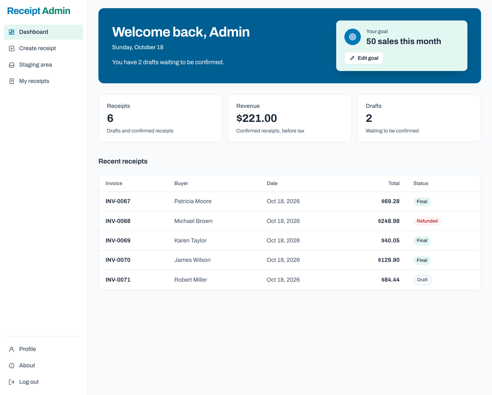
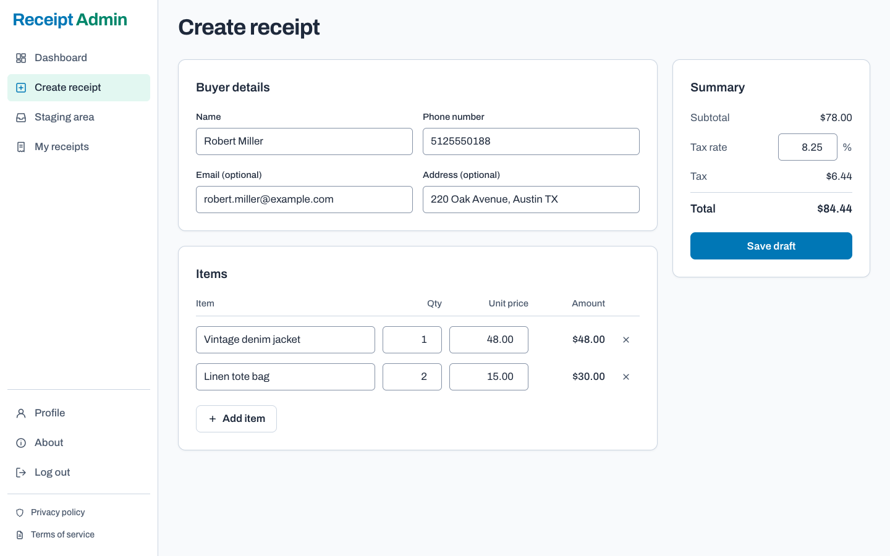
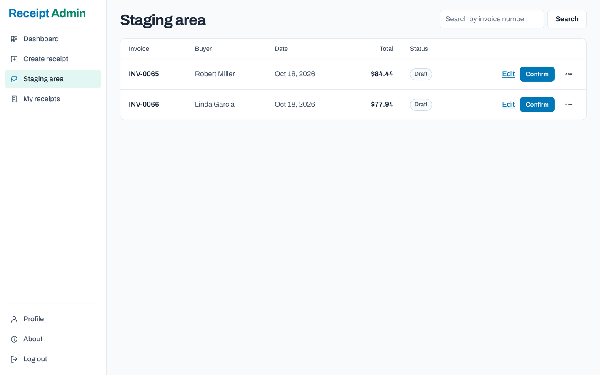
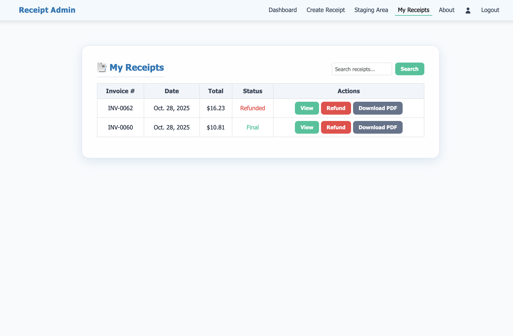

# Receipt Admin

[](https://github.com/Aayushkumar-gupta/Receipt-Admin/actions/workflows/ci.yml)


**Professional receipts for people who sell on Instagram, Facebook Marketplace, and other social platforms.**

**Live:** [receiptadmin.com](https://receiptadmin.com) · free to sign up



## Why I built it

A growing number of small businesses sell through Instagram DMs, Facebook Marketplace listings, and local meetups. They have no storefront and no point-of-sale system, so when a buyer asks for a receipt, or tax season arrives, there is nothing to show: just a scattered trail of chats and payment notifications.

Receipt Admin gives these sellers what a cash register gives a shop. They can write up a sale in under a minute, hand the buyer a clean PDF receipt, and keep every sale on record in one place, with their revenue at a glance.

Unlike traditional accounting and point-of-sale software, Receipt Admin focuses on a simple workflow for independent social sellers: record a sale, generate a professional receipt, and track revenue without setting up a full business management system.

It isn't tied to any one kind of business. Whether someone sells shoes, T-shirts, home decor, or a sofa or table on Marketplace, every sale is recorded the same way: describe the items, set the prices, and the receipt is ready.

## How it works

1. **Write up the sale:** add the buyer's details and the items sold. Line prices, tax, and totals are calculated automatically.
2. **Review the draft:** new receipts wait in a staging area, where mistakes can be fixed or the draft deleted.
3. **Confirm it:** the receipt becomes final, with its own invoice number (`INV-0001`, `INV-0002` and so on).
4. **Send it:** download the receipt as a PDF and share it with the buyer.
5. **Stay on top of the business:** the dashboard shows total receipts, revenue, and pending drafts; refunds are tracked per receipt.

| Create a receipt | Review drafts | Finalized receipts |
| --- | --- | --- |
|  |  |  |

## Features

- Receipts with any number of line items and a configurable tax rate
- Draft, review and confirm workflow, so mistakes are caught before a receipt is official
- PDF receipts to view in the browser or download and send
- Refund tracking and search by invoice number
- Dashboard with receipt count, revenue, pending drafts, and recent sales
- Accounts with email verification, password reset and change, and self-service deletion that removes all of a seller's data
- A short profile check that asks for any missing seller details before the first receipt
- Each seller sees only their own receipts and data

## Engineering highlights

Receipts are financial records, so the app is built to keep them correct and private.

- **Data isolation:** every receipt query is scoped to the logged-in seller; anyone else's receipt returns a 404, never a "permission denied" that would reveal it exists.
- **Server-side money math:** totals, tax, and line prices are recalculated with `Decimal` on the server and rounded half-up, never trusted from the browser.
- **Atomic writes:** creating or editing a receipt runs in a database transaction, so a failure can't leave a receipt half-saved or lose its items.
- **Collision-safe invoice numbers:** numbers are derived from the database row id, so two receipts saved at the same moment can't get the same number.
- **Account security:** login rate limiting (5 attempts, then a 15-minute lockout), signed email-verification links that expire, POST-only and CSRF-protected state changes, and safe post-login redirects.
- **Production hardening:** secrets from environment variables, HTTPS with HSTS and secure cookies, and the app refuses to start without a secret key.
- **Tested and automated:** a test suite covering 100% of the views, models, and utilities, run by GitHub Actions on every push together with linting and a missing-migrations check. Dependabot proposes dependency updates weekly.

## Tech stack

| Area | Technology |
| --- | --- |
| Backend | Python 3.13, Django 6.1 |
| Database | PostgreSQL in production (psycopg 3), SQLite for local development |
| PDF generation | xhtml2pdf |
| Email | Resend API |
| Frontend | Django templates, Tailwind CSS 4, vanilla JavaScript |
| Hosting | Render (Gunicorn, WhiteNoise for static files) |
| Quality | Django test suite, coverage, Ruff, pre-commit, GitHub Actions, Dependabot |

## Run it locally

Requires Python 3.13.

```bash
git clone https://github.com/Aayushkumar-gupta/Receipt-Admin.git
cd Receipt-Admin
python3.13 -m venv venv
source venv/bin/activate
pip install -r requirements-dev.txt
pre-commit install
python manage.py migrate
python manage.py runserver
```

Then open http://127.0.0.1:8000.

No configuration is needed: the app uses SQLite and a development secret key, and prints email verification and password reset links to the terminal instead of sending them. To use the admin site, create an account with `python manage.py createsuperuser`.

### Styles

The compiled stylesheet, `receipts/static/receipts/css/app.css`, is committed, so the app runs and deploys without any frontend tooling. To change the styles, edit `receipts/tailwind/input.css` or the templates, then rebuild with the [Tailwind CSS standalone CLI](https://tailwindcss.com/blog/standalone-cli), which needs no Node.js:

```bash
# one time: download the CLI for your platform (macOS Apple silicon shown)
curl -sLo bin/tailwindcss https://github.com/tailwindlabs/tailwindcss/releases/download/v4.3.3/tailwindcss-macos-arm64
chmod +x bin/tailwindcss

# rebuild after a change, or add --watch while working
bin/tailwindcss -i receipts/tailwind/input.css -o receipts/static/receipts/css/app.css --minify
```

Builds for other platforms are listed on the [release page](https://github.com/tailwindlabs/tailwindcss/releases/tag/v4.3.3).

## Configuration

Settings are read from environment variables, or from a `.env` file in the project root (see [`.env.example`](.env.example)).

| Variable | Local | Production | Purpose |
| --- | --- | --- | --- |
| `DJANGO_ENV` | `local` (default) | anything else | Switches between local and production settings |
| `DJANGO_SECRET_KEY` | optional | **required** | Django secret key |
| `DATABASE_URL` | optional (SQLite) | **required** | Database connection string |
| `RESEND_API_KEY` | optional | **required** | Sends verification and password reset emails |

## Tests and code quality

```bash
python manage.py test                              # run the test suite
coverage run manage.py test && coverage report     # with coverage
ruff check . && ruff format --check .              # lint and formatting
```

## Deployment

The app runs on [Render](https://render.com):

- **Build command:** `pip install -r requirements.txt && python manage.py collectstatic --noinput && python manage.py migrate`
- **Start command:** `gunicorn ReceiptAdmin.wsgi` (from the `Procfile`)
- **Health check:** `/health/` returns `{"status": "ok"}`

## Project structure

```
ReceiptAdmin/   Project settings and URL configuration
accounts/       Sign-up, login, email verification, password reset and change, profiles, account deletion
receipts/       Receipts, PDFs, dashboard, templates, and static files
```

## License

Copyright © 2025–2026 Aayush Kumar Gupta. All rights reserved. The code is published for viewing only; see [LICENSE](LICENSE).
